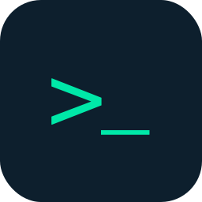

<p align="center">
  
</p>

<h1 align="center">parqet-cli</h1>

<p align="center">
  Query your <a href="https://parqet.com">Parqet</a> portfolio from the command line or from AI agents.<br />
  Unofficial, community-maintained.
</p>

<p align="center">
  <a href="https://buymeacoffee.com/michaeljauk">
    
  </a>
</p>

<p align="center">
  <a href="https://github.com/michaeljauk/parqet-cli/actions/workflows/ci.yml"></a>
  <a href="https://github.com/michaeljauk/parqet-cli/actions/workflows/codeql.yml"></a>
  <a href="https://www.npmjs.com/package/parqet-cli"></a>
  <a href="https://www.npmjs.com/package/parqet-cli"></a>
  <a href="LICENSE"></a>
</p>

---

## Why

Parqet has a web app and an OAuth API, but no command-line client. parqet-cli adds one:

- Fetch holdings, performance, and activities for any portfolio.
- Print the result as `table`, `json`, or `markdown`.
- Use it in scripts and CI: it has exit codes, environment variables, and a non-interactive mode.
- Let AI agents query your portfolio through the bundled [Claude Code](https://claude.ai/code) skill.

Typical use cases:

- See your portfolio value and return in the terminal
- Write your holdings into a Markdown note
- Record performance on a schedule, for example from a cron job
- Ask an AI agent about your holdings and transactions

## Installation

```sh
npm install -g parqet-cli
```

Authenticate once after install:

```sh
parqet auth login   # opens browser for OAuth
```

## Commands

```sh
# Portfolios
parqet portfolio list
parqet portfolio show <id>
parqet portfolio show <id> --timeframe 1y

# Holdings
parqet portfolio holdings <id>

# Activities (transactions)
parqet portfolio activities <id>
parqet portfolio activities <id> --limit 50

# Auth
parqet auth login                # authorize via browser
parqet auth login --no-browser   # headless flow: print URL, paste redirect back
parqet auth status               # check token status
parqet auth logout               # remove stored credentials
```

### Headless / remote servers

On machines without a browser (headless Linux, SSH-only boxes), use:

```sh
parqet auth login --no-browser
```

The command prints an authorization URL. Open it on any device, then copy the
redirect URL from the browser's address bar and paste it into the prompt. The
localhost page does not need to load.

### Timeframes

`1d` `1w` `mtd` `1m` `3m` `6m` `1y` `ytd` `3y` `5y` `10y` `max`

## Output formats

Every command accepts `--output table|json|markdown` (default: `table`):

```sh
parqet portfolio list --output json
parqet portfolio holdings <id> --output markdown >> holdings.md
```

In CI environments (`CI=true`), JSON is the default.

## Scripts and agents

### Exit codes

| Code | Meaning |
|------|---------|
| `0` | Success |
| `1` | Error |
| `2` | Not authenticated: run `parqet auth login` |

### Environment variables

| Variable | Description |
|----------|-------------|
| `PARQET_TOKEN` | Override stored access token (useful in CI) |
| `PARQET_QUIET=1` | Suppress info messages |
| `NO_COLOR=1` | Disable ANSI colors |
| `CI=true` | Non-interactive mode, defaults to JSON output |

Tokens are stored at `~/.config/parqet-cli/tokens.json` (mode 600). If a command exits with code `2`, the token is missing or expired.

### jq examples

```sh
# Current portfolio value
parqet portfolio show <id> --output json | jq '.performance.valuation.atIntervalEnd'

# YTD return in percent
parqet portfolio show <id> --output json | jq '.performance.unrealizedGains.inInterval.returnGross'

# Holdings sorted by current value
parqet portfolio holdings <id> --output json | jq '[.[] | {name: .asset.name, value: .position.currentValue}] | sort_by(-.value)'
```

## Claude Code skill

parqet-cli contains a Claude Code skill. A global install (`npm install -g parqet-cli`) copies it to
`~/.claude/skills/parqet/`, with no further setup. In Claude Code, run `/parqet` to let Claude query
your portfolio.

## Development

```sh
bun install
bun run generate    # regenerate types from OpenAPI spec
bun run typecheck
bun test
bun run build
```

## Disclaimer

Unofficial and not affiliated with [Parqet](https://parqet.com). "Parqet" is their trademark.

## Support

Built by [Michael Jauk](https://github.com/michaeljauk). If this saves you time, consider
[buying me a coffee](https://buymeacoffee.com/michaeljauk).

## License

[MIT](./LICENSE) © Michael Jauk
